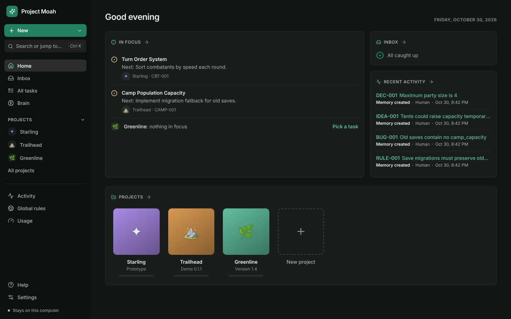
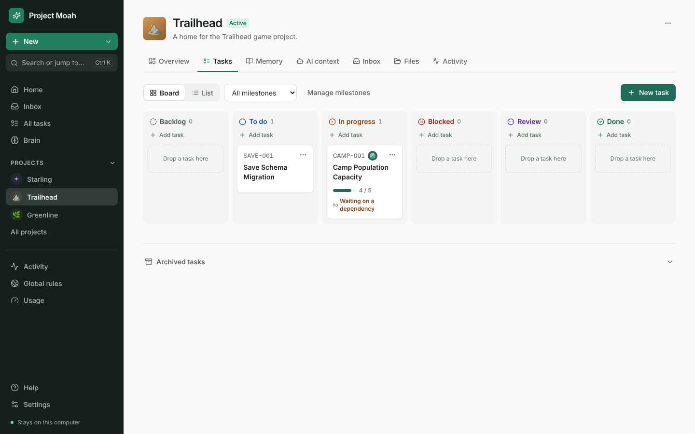

# Project Moah

**A shared memory and task board for your AI coding agents, that lives on your computer.**

Claude Code and Codex forget everything between sessions. Project Moah gives them one place to read and write what matters: your tasks, decisions, rules, known issues and where you left off. You see and steer all of it in a desktop app. *Moah* means "brain" in Hebrew.



## What it does

- **Tasks** on a board or a list, with milestones, requirements and a "current focus" your agents start from.
- **Memory**: decisions, rules, facts, ideas, known issues, notes and warnings. Lock what agents must not change.
- **Context packs**: each agent session gets a short, ranked summary of what it needs, instead of your whole history.
- **Inbox**: agents suggest changes to locked things; nothing changes until you accept.
- **Checkpoints and handoffs**: pick up where the last session stopped, with any agent.
- **Brain view**: see how your memory links together, and what agents never reach.



## Private by design

- Everything stays on your computer in one local database. No account, no cloud, no telemetry, no automatic updates.
- The app never goes online. Agents talk to it through a local connection. The Flatpak version has no network permission at all.
- It reads your repository's file names, Git status and commit messages, and never changes your code.

## Install

Pick your system. Each link always gets the newest version.

| Your system | Download |
| --- | --- |
| Windows 10 or 11 | [ProjectMoah-Setup-x64.exe](https://github.com/Namache/project-moah/releases/latest/download/ProjectMoah-Setup-x64.exe) |
| Debian 12+, Ubuntu 22.04+, Linux Mint and similar | [ProjectMoah-amd64.deb](https://github.com/Namache/project-moah/releases/latest/download/ProjectMoah-amd64.deb) |
| Fedora, Bazzite and any other Linux with Flatpak | [ProjectMoah-x86_64.flatpak](https://github.com/Namache/project-moah/releases/latest/download/ProjectMoah-x86_64.flatpak) |

All files and release notes are on the [releases page](../../releases/latest).

### Windows

1. [Download the installer](https://github.com/Namache/project-moah/releases/latest/download/ProjectMoah-Setup-x64.exe) and run it.
2. Windows may say "Windows protected your PC", because the installer is not signed yet (see the [code signing policy](#code-signing-policy)). Choose **More info**, then **Run anyway**.
3. Open **Project Moah** from the Start menu.

To show Git details for your repositories, also install [Git for Windows](https://git-scm.com/download/win). Everything else works without it.

### Debian and Ubuntu

Paste this into a terminal:

```bash
cd /tmp && wget -O ProjectMoah-amd64.deb https://github.com/Namache/project-moah/releases/latest/download/ProjectMoah-amd64.deb && sudo apt install ./ProjectMoah-amd64.deb
```

Then open **Project Moah** from your app menu. Or download the `.deb` from the table above and open it with your software center.

To remove it later: `sudo apt remove project-moah`.

### Fedora, Bazzite and other Linux, with Flatpak

Fedora and Bazzite already have Flatpak. On other systems, install it from your package manager first. Then paste this into a terminal:

```bash
flatpak remote-add --if-not-exists --user flathub https://dl.flathub.org/repo/flathub.flatpakrepo
cd /tmp && curl -LO https://github.com/Namache/project-moah/releases/latest/download/ProjectMoah-x86_64.flatpak && flatpak install --user ProjectMoah-x86_64.flatpak
```

Then open **Project Moah** from your app menu. The first install also downloads the Flatpak runtime the app runs on, so it takes a little longer.

To remove it later: `flatpak uninstall --user io.github.projectbrain.ProjectBrain`.

## Connect your AI agent

Open the app and go to **Help → Connect Claude Code** (or **Connect Codex**). The commands there are made for the way you installed the app, so copy them as they are, once. From then on, every session can use Project Moah. No API key is needed.

## Your data

Your database stays in one folder, and uninstalling the app leaves it there:

| Installed with | Folder |
| --- | --- |
| Windows installer | `%LOCALAPPDATA%\project-brain\` |
| `.deb` | `~/.local/share/project-brain/` |
| Flatpak | `~/.var/app/io.github.projectbrain.ProjectBrain/data/project-brain/` |

**Settings → Data** shows the exact place. Make a copy any time with **Export Project Moah backup** there.

## Code signing policy

The Windows installer is not code-signed yet. Signing through the [SignPath Foundation](https://signpath.org), which signs open-source projects for free, is planned.

- **Builds:** only files built by this repository's public [GitHub Actions workflow](.github/workflows/desktop.yml) from its own source get signed. Nothing built on a personal computer is signed.
- **Authors and reviewers:** the repository owner, [Namache](https://github.com/Namache). Every outside contribution (pull request) is reviewed by the owner before it is merged.
- **Approvers:** the repository owner approves every signing request.
- **Privacy:** this program will not transfer any information to other networked systems unless specifically requested by the user or the person installing or operating it.

## License

[MIT](LICENSE)
