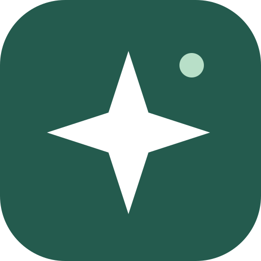
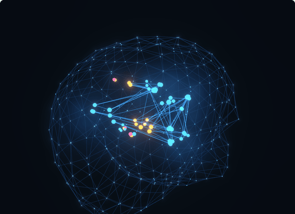

<p align="center">
  
</p>

<h1 align="center">Project Moah</h1>

<p align="center">
  <strong>An artificial brain for your AI coding agents.</strong><br>
  <em>Moah</em> (מוח) is Hebrew for "brain": one shared, local memory for Claude Code, Codex and every agent you run.
</p>

<p align="center">
  <a href="https://github.com/Namache/project-moah/releases/latest"></a>
  <a href="LICENSE"></a>
  
  
  
</p>

<p align="center">
  <a href="https://github.com/Namache/project-moah/releases/latest/download/ProjectMoah-Setup-x64.exe"></a>
  <a href="https://github.com/Namache/project-moah/releases/latest/download/ProjectMoah-amd64.deb"></a>
  <a href="https://github.com/Namache/project-moah/releases/latest/download/ProjectMoah-x86_64.flatpak"></a>
</p>

<p align="center">
  
</p>

---

> **Your agents forget everything between sessions. Moah doesn't.** One brain on your own computer that every agent reads from and writes to, so the next session starts where the last one stopped.

---

## What it does

| | What Moah does | Where |
|---|---|---|
| **Remembers** | Tasks, decisions, rules, facts, known issues and warnings, in one local database. Lock what agents must not change. | Tasks, Memory |
| **Briefs** | Every agent session starts with your rules and a short, ranked pack for its task, instead of your whole history. | Context packs |
| **Links** | Records are connected the way they relate: a bug *caused by* a decision, a task that *uses* a rule. | Brain |
| **Learns** | Links that lead to useful records get stronger, unused ones fade. | Brain health |
| **Asks first** | Agents suggest changes to locked things; nothing changes until you accept. | Inbox |
| **Hands off** | Checkpoints let any agent, Claude Code or Codex, pick up where the last one stopped. | Checkpoints |

---

## How the brain works

**Memory is only useful when it is linked.** A pile of notes is just something to search. When an agent starts a task, Moah follows the links out from it and brings what is connected, not everything you ever wrote.

**Shelves** sort everything into one tree of topics that all your projects share, from broad to narrow: Knowledge › Game development › Game design › Combat. Shelves that match the task wake up and the rest stay asleep, so unrelated knowledge stays out. New records are filed on shelves automatically.

**How links decide what comes along:**

- Each link has a weight from 0 to 1: how strong it is, times how sure Moah is of it. A link you made counts fully; one Moah only guessed waits until you or an agent confirm it.
- Relevance flows out from the task. A record one link away scores the link's weight; every further hop is also multiplied by 0.85.
- Several routes to the same record add up like independent chances: two routes of 50% give 75% (1 − 0.5 × 0.5), and nothing ever reaches 100%.
- Records scoring under 20% stay out of the pack.

**Links learn.** When an agent reports that a record helped, the links that led to it gain 0.08 for that kind of work, and lose 0.08 when it didn't. Links nobody uses fade slowly after a month. Packs are predictable: the same request gives the same pack. If you want Moah to try out new links, turn on **Let packs explore** in Settings > Agents: packs then draw link weights from their track record ([Thompson sampling](https://en.wikipedia.org/wiki/Thompson_sampling)), so a new link sometimes gets its chance while proven ones almost always win.

---

## Unlike a notes file

| | A notes file (CLAUDE.md, AGENTS.md) | **Project Moah** |
|---|---|---|
| What the agent reads | The whole file, every session | Only what links to the task |
| Across projects | One file per repository | One brain; topics shared by every project |
| Across agents | A separate file for each agent | Claude Code and Codex share one memory |
| Keeping it tidy | You, by hand | Shelves file new records; links learn what helps |
| Changing a rule | Anyone edits it, silently | Locked memory changes only with your OK |

---

## Install

**The easy way:** tell Claude Code or Codex:

```text
Install and connect https://github.com/Namache/project-moah
```

Your agent follows [INSTALL.md](INSTALL.md) and does the rest. Agents: start there.

Or download your file with the buttons above (each always gets the newest version), or pick one from the [latest release](https://github.com/Namache/project-moah/releases/latest), which also lists what changed.

<details>
<summary><strong>Windows 10 and 11</strong></summary>

<br>

1. [Download the installer](https://github.com/Namache/project-moah/releases/latest/download/ProjectMoah-Setup-x64.exe) and run it.
2. Windows may say "Windows protected your PC", because the installer is not signed yet (see the [code signing policy](CODE_SIGNING.md)). Choose **More info**, then **Run anyway**.
3. Open **Project Moah** from the Start menu.

To show Git details for your repositories, also install [Git for Windows](https://git-scm.com/download/win). Everything else works without it.

</details>

<details>
<summary><strong>Debian 12+, Ubuntu 22.04+, Linux Mint</strong></summary>

<br>

Paste this into a terminal, then open **Project Moah** from your app menu:

```bash
cd /tmp && wget -O ProjectMoah-amd64.deb https://github.com/Namache/project-moah/releases/latest/download/ProjectMoah-amd64.deb && sudo apt install ./ProjectMoah-amd64.deb
```

Or open the downloaded `.deb` with your software center. To remove it later: `sudo apt remove project-moah`.

</details>

<details>
<summary><strong>Fedora, Bazzite and other Linux (Flatpak)</strong></summary>

<br>

Fedora and Bazzite already have Flatpak; elsewhere, install it from your package manager first. Then paste this into a terminal and open **Project Moah** from your app menu:

```bash
flatpak remote-add --if-not-exists --user flathub https://dl.flathub.org/repo/flathub.flatpakrepo
cd /tmp && curl -LO https://github.com/Namache/project-moah/releases/latest/download/ProjectMoah-x86_64.flatpak && flatpak install --user --or-update ProjectMoah-x86_64.flatpak
```

The first install also downloads the Flatpak runtime, so it takes a little longer. To remove it later: `flatpak uninstall --user io.github.projectbrain.ProjectBrain`.

</details>

**Connect your agent:** open the app, go to **Help → Connect Claude Code**, and choose **Connect Claude Code and Codex**. On the Flatpak, Help gives you one command to paste instead. Then restart your agent.

**Update:** there are no automatic updates, so nothing goes online behind your back. To update, run the same download and install again: the Windows installer, the `.deb` command or the Flatpak command above. Your data stays where it is. If you say yes when your agent offers an update, it does this for you, restarts Project Moah and tells you when it is ready.

---

## Private by design

**Nothing leaves your computer.** No account, no cloud, no telemetry, no automatic updates. The app never goes online; agents talk to it through a local connection, and the Flatpak has no network permission at all.

**Your code stays yours.** Moah reads your repository's file names, Git status and commit messages, and never changes your code.

**Your data is one file.** Back it up any time with **Settings → Data → Export Project Moah backup**. Uninstalling the app leaves it where it is.

<details>
<summary><strong>Where your data lives</strong></summary>

<br>

| Installed with | Folder |
|---|---|
| Windows installer | `%LOCALAPPDATA%\project-brain\` |
| `.deb` | `~/.local/share/project-brain/` |
| Flatpak | `~/.var/app/io.github.projectbrain.ProjectBrain/data/project-brain/` |

</details>

<details>
<summary><strong>Screenshots</strong></summary>

<br>


</details>

---

## Contributing

Contributions are welcome, from typo fixes to new features.

- **Found a bug or have an idea?** [Open an issue](https://github.com/Namache/project-moah/issues/new/choose). Search the [existing ones](https://github.com/Namache/project-moah/issues) first.
- **Want to change something?** Fork the repository, make your change on a branch and open a pull request. For anything big, open an issue first so we agree on the approach.
- **Double-check before you send it:** run `./scripts/check.sh`, try the change in the app, and read every line of your diff, including code an AI wrote for you.

Read the [contributing guide](CONTRIBUTING.md) for the details.

---

<p align="center">
  <strong>⭐ Star the repo if Moah helps your agents remember</strong>
</p>

<p align="center">
  <a href="LICENSE">MIT License</a> · <a href="CONTRIBUTING.md">Contributing</a> · <a href="SECURITY.md">Security</a> · <a href="CODE_SIGNING.md">Code signing policy</a>
</p>
